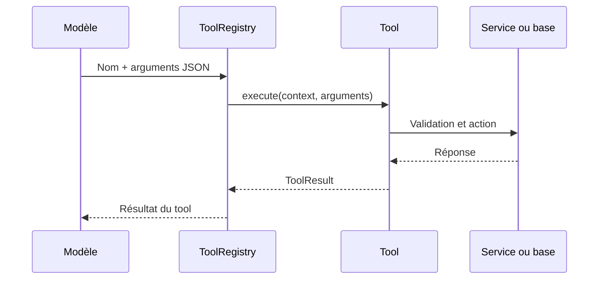

# 🧰 12. Architecture des context tools

Cette page explique comment les **context tools** sont organisés.

Un context tool est une fonction que l'IA peut appeler pour agir sur le monde
extérieur.

Exemples :

- envoyer un message Discord ;
- rechercher un souvenir ;
- créer un événement ;
- envoyer un email.

[⬅️ Retour au sommaire](README.md)

---

## 🎯 Le rôle d'un tool

Un tool donne à l'IA une capacité précise.

L'IA ne lance pas directement une fonction Python.

Elle reçoit d'abord une **description JSON**.

Cette description contient :

- le nom du tool ;
- sa description ;
- ses paramètres ;
- les paramètres obligatoires.

Quand le modèle choisit un tool, SensAI transmet l'appel à la classe
correspondante.

---

## 🧱 Les trois objets communs

Le fichier [`src/tools/ITools.py`](../src/tools/ITools.py) définit les objets
partagés par tous les tools.

### `ToolContext`

`ToolContext` décrit l'utilisateur qui demande l'action.

```python
ToolContext(
    user_id="user-123",
    user_email="user@example.com",
    user_token="..."
)
```

Les champs sont :

| Champ | Rôle |
|---|---|
| `user_id` | Identifiant de l'utilisateur |
| `user_email` | Adresse utilisée par le tool email |
| `user_token` | Jeton disponible pour une intégration externe |

### `ToolResult`

`ToolResult` contient la réponse uniforme d'un tool.

```python
ToolResult(
    success=True,
    message="Event created.",
    data={"id": "0"}
)
```

| Champ | Rôle |
|---|---|
| `success` | `True` si l'action a réussi |
| `message` | Résumé lisible du résultat |
| `data` | Résultat structuré optionnel |

### `ToolsInterface`

Chaque tool concret doit fournir :

```python
class MyTool(ToolsInterface):
    @property
    def name(self) -> str:
        ...

    @property
    def description(self) -> str:
        ...

    @property
    def parameters(self) -> dict:
        ...

    def execute(self, context: ToolContext, arguments: dict) -> ToolResult:
        ...
```

Cette interface impose la même forme à tous les tools.

---

## 🗂️ Le registre

Le fichier [`src/tools/registry.py`](../src/tools/registry.py) contient
`ToolRegistry`.

Le registre fait deux choses.

### 1. Exposer les tools au modèle

```python
registry.definition()
```

Retourne une liste au format function calling :

```json
[
  {
    "type": "function",
    "function": {
      "name": "calendar",
      "description": "Create, list, and cancel calendar events...",
      "parameters": {}
    }
  }
]
```

### 2. Exécuter un tool par son nom

```python
registry.execute(
    "calendar",
    context,
    {"action": "list", "...": "..."}
)
```

Le registre :

1. cherche le nom dans son dictionnaire interne ;
2. refuse un nom inconnu ;
3. appelle `tool.execute(...)` ;
4. retourne le `ToolResult`.

---

## 🔄 Trajet d'un appel



En pratique :

1. Le modèle demande une action.
2. Le registre choisit la classe.
3. Le tool valide les arguments.
4. Le tool vérifie l'utilisateur quand c'est nécessaire.
5. Le tool réalise l'action.
6. Le tool transforme la réponse en `ToolResult`.

---

## 📁 Organisation des fichiers

```text
src/tools/
├── ITools.py                    → Interface et objets communs
├── context.py                   → Ré-export de ToolContext
├── result.py                    → Ré-export de ToolResult
├── registry.py                  → Registre et dispatch
├── calendar/
│   └── calendar_tools.py        → Agenda en mémoire
├── diagnostic/
│   └── selftest_tool.py         → Tool de test (echo / échec simulé)
├── communication/
│   ├── email.py                 → Email SMTP
│   ├── telegram.py              → Telegram Bot API
│   ├── discord.py               → Messages privés Discord
│   └── communication_tools.py   → Fonctions de notification génériques
├── memory/
│   └── memory_tools.py          → Mémoire courte et longue
└── tasks/
    ├── create_task.py           → Création et planification
    ├── complete_task.py         → Passage au statut completed
    └── send_task_file.py        → Export JSON structuré
```

Les trois fichiers dans `tasks/` sont maintenant des tools indépendants.

Ils peuvent être enregistrés séparément dans `ToolRegistry`.

```python
tools = [
    CreateTask(session_factory),
    CompleteTask(session_factory),
    SendTaskFile(session_factory),
]
```

Chaque tool reçoit une fabrique de sessions SQLAlchemy.

Cela permet d'ouvrir une session courte pour chaque appel.

---

## ⏰ Architecture des tâches

Les tâches sont sauvegardées dans le modèle `ScheduledTask`.

Une tâche contient :

| Propriété | Rôle |
|---|---|
| `id` | Identifiant UUID de la tâche |
| `profile_id` | Propriétaire de la tâche |
| `prompt` | Instruction à exécuter |
| `scheduled_at` | Date et heure d'exécution |
| `recurrence` | Règle de répétition optionnelle |
| `status` | État de la tâche |

Les tools utilisent `context.user_id` comme `profile_id`.

Une tâche ne peut donc être lue ou modifiée que par son propriétaire.

Les états utilisés par le système sont notamment :

- `pending` ;
- `completed` ;
- `cancelled` ;
- `failed`.

---

## 🔐 Validation et isolation

La validation se fait dans chaque tool.

Exemples :

- `Calendar` vérifie les dates et le propriétaire de l'événement ;
- `Email` vérifie les adresses email ;
- `Discord` vérifie l'identifiant numérique du destinataire ;
- `Telegram` vérifie l'existence publique du destinataire ;
- `Memory` vérifie que la session appartient à l'utilisateur courant.

Les secrets ne doivent pas être écrits dans le code.

Les intégrations Discord et Telegram lisent leurs jetons depuis les variables
d'environnement.

---

## ⚠️ Limites actuelles

- Le registre doit recevoir explicitement les instances des tools.
- L'agenda est stocké en mémoire RAM.
- Le tool email suppose un serveur SMTP local.
- Les implémentations SMS, Slack et push du module générique sont des
  placeholders.
- Les tools de tâches créent, complètent et exportent les tâches.
- La création d'une tâche ne valide pas encore la syntaxe de `recurrence` ;
  cette validation est appliquée par le gestionnaire lors de la répétition.
- `tools_selftest` est exposé au modèle comme les autres tools : sa description lui
  demande de ne l'utiliser que si l'utilisateur veut tester les outils.
- Les logs d'appels d'outils sont affichés dans la CLI uniquement ; la webapp ne les
  affiche pas encore (seul le visualiseur montre l'étape « tools »).
- L'export de tâche retourne des données JSON compatibles, mais ne crée pas
  encore un fichier physique ni un envoi vers un canal externe.

---

[⬅️ Page précédente : Intent classifier](11-intent-classifier.md) ·
[➡️ Page suivante : Utiliser les context tools](13-context-tools.md)
