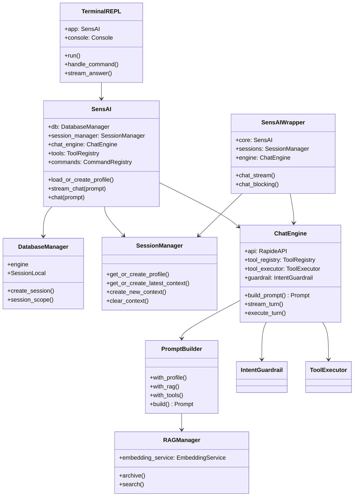
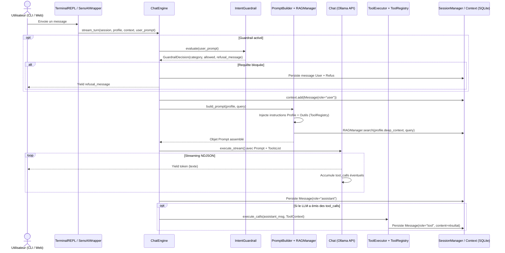

# Walkthrough — Refonte Architecturale Multiclasses de SensAI

Ce document détaille l'ensemble des changements réalisés pour transformer **SensAI** en une architecture orientée objet modulaire, éliminer les fonctions procédurales trop longues et supprimer les duplications de code.

---

## 1. Vue d'ensemble de la nouvelle architecture

Auparavant, la classe [`SensAI`](file:///home/lejih/epitech/AIA-500/SensAI/src/main.py#L25) concentrait toutes les responsabilités (connexion SQLAlchemy, requêtes ORM, RAG, construction de prompt, exécution du flux LLM), et cette logique était dupliquée dans [`SensAIWrapper`](file:///home/lejih/epitech/AIA-500/SensAI/src/galerelm/wrapper.py#L19) et [`src/repl.py`](file:///home/lejih/epitech/AIA-500/SensAI/src/repl.py).

L'application est désormais découpée en **couches de responsabilités uniques (Single Responsibility Principle)** :

---

## 2. Cycle de vie d'une requête (Comment fonctionne l'application désormais)

Que l'utilisateur interagisse depuis le **Terminal** ([`TerminalREPL`](file:///home/lejih/epitech/AIA-500/SensAI/src/repl.py#L37)) ou depuis l'**Application Web Gradio** ([`SensAIWrapper`](file:///home/lejih/epitech/AIA-500/SensAI/src/galerelm/wrapper.py#L19)), chaque message suit désormais un pipeline unique orchestré par [`ChatEngine.stream_turn()`](file:///home/lejih/epitech/AIA-500/SensAI/src/galerelm/engine.py#L179-L217) :

---

## 3. Détail des refontes par module

### A. Système de Prompts orienté objet ([`src/galerelm/models/prompt.py`](file:///home/lejih/epitech/AIA-500/SensAI/src/galerelm/models/prompt.py))
* **Problème initial** : Chaînes de caractères brutes dispersées dans `src/main.py`, `intent_classifier.py` et `tempmodel/`, avec des variables `{persona}` et `{prompt}` jamais formatées.
* **Solution mise en place** :
  * [`PromptTemplate`](file:///home/lejih/epitech/AIA-500/SensAI/src/galerelm/models/prompt.py#L98-L175) : Parse automatiquement les variables attendues via `string.Formatter`, valide qu'aucune variable ne manque lors de l'appel à [`render()`](file:///home/lejih/epitech/AIA-500/SensAI/src/galerelm/models/prompt.py#L121-L136), et fournit les modèles prédéfinis [`default_system()`](file:///home/lejih/epitech/AIA-500/SensAI/src/galerelm/models/prompt.py#L159), [`intent_classifier()`](file:///home/lejih/epitech/AIA-500/SensAI/src/galerelm/models/prompt.py#L168) et [`ambiguity_resolver()`](file:///home/lejih/epitech/AIA-500/SensAI/src/galerelm/models/prompt.py#L173).
  * [`PromptBuilder`](file:///home/lejih/epitech/AIA-500/SensAI/src/galerelm/models/prompt.py#L227-L389) : Assemble de façon fluide les instructions du profil (`.with_profile()`), les souvenirs RAG (`.with_rag()`), les outils disponibles (`.with_tools()`) et les règles additionnelles (`.with_rules()`) pour produire un objet [`Prompt`](file:///home/lejih/epitech/AIA-500/SensAI/src/galerelm/models/prompt.py#L178-L224) directement accepté par [`Chat`](file:///home/lejih/epitech/AIA-500/SensAI/src/galerelm/models/chat.py#L34).

### B. Découplage de `SensAI`, `SensAIWrapper` et création de `ChatEngine`
* **Problème initial** : Triple duplication du flux de chat entre `SensAI.chat()`, `SensAIWrapper` et `repl.py` ; requêtes SQLAlchemy dupliquées ; `DeepContext` non créé dans `SensAIWrapper.create_profile()`.
* **Solution mise en place** :
  * [`DatabaseManager`](file:///home/lejih/epitech/AIA-500/SensAI/src/galerelm/database.py#L18-L45) : Gère le moteur SQLAlchemy, la création des tables et fournit le context manager transactionnel [`session_scope()`](file:///home/lejih/epitech/AIA-500/SensAI/src/galerelm/database.py#L35-L42).
  * [`SessionManager`](file:///home/lejih/epitech/AIA-500/SensAI/src/galerelm/session_manager.py#L24-L154) : Centralise toute la gestion des entités [`Profile`](file:///home/lejih/epitech/AIA-500/SensAI/src/galerelm/models/profile.py#L16), [`Context`](file:///home/lejih/epitech/AIA-500/SensAI/src/galerelm/models/context.py#L21) et [`DeepContext`](file:///home/lejih/epitech/AIA-500/SensAI/src/galerelm/models/deep_context.py#L20) (en garantissant que `DeepContext` est toujours initialisé).
  * [`ChatEngine`](file:///home/lejih/epitech/AIA-500/SensAI/src/galerelm/engine.py#L26-L237) : Orchestre l'intégralité d'un tour de conversation en mode streaming (`stream_turn`) ou bloquant (`execute_turn`).

### C. Interface Terminal [`TerminalREPL`](file:///home/lejih/epitech/AIA-500/SensAI/src/repl.py#L37-L116) et [`src/commands/`](file:///home/lejih/epitech/AIA-500/SensAI/src/commands/__init__.py)
* **Problème initial** : `src/repl.py` contenait 291 lignes de fonctions libres et redéfinissait toutes les commandes `/help`, `/clear`, `/recall`, etc. dans un dictionnaire `_commands`, ignorant le package orienté objet `src/commands/`.
* **Solution mise en place** :
  * [`TerminalREPL`](file:///home/lejih/epitech/AIA-500/SensAI/src/repl.py#L37-L116) encapsule l'interface `Rich` et délègue toutes les commandes `/` à [`CommandRegistry.dispatch()`](file:///home/lejih/epitech/AIA-500/SensAI/src/commands/registry.py#L46).
  * Correction des commandes [`RecallCommand`](file:///home/lejih/epitech/AIA-500/SensAI/src/commands/memory.py#L8), [`ContextCommand`](file:///home/lejih/epitech/AIA-500/SensAI/src/commands/debug.py#L26) et [`MemoriesCommand`](file:///home/lejih/epitech/AIA-500/SensAI/src/commands/debug.py#L61) pour cibler `app.profile.deep_context`.

### D. Système Multi-Outils unifié ([`src/tools/`](file:///home/lejih/epitech/AIA-500/SensAI/src/tools/__init__.py))
* **Problème initial** : Outils non reliés à `Chat`, incompatibilité entre `ToolRegistry.definition()` et `ToolsList`, fichiers vides dans `src/tools/tasks/` et `src/tools/memory/`, et code procédural dans `communication_tools.py`.
* **Solution mise en place** :
  * [`ToolsInterface.to_model()`](file:///home/lejih/epitech/AIA-500/SensAI/src/tools/ITools.py#L49-L57) et [`ToolRegistry.to_tools_list()`](file:///home/lejih/epitech/AIA-500/SensAI/src/tools/registry.py#L36-L38) unifient les outils avec [`ToolsList`](file:///home/lejih/epitech/AIA-500/SensAI/src/galerelm/models/tools.py#L71).
  * [`ToolExecutor`](file:///home/lejih/epitech/AIA-500/SensAI/src/tools/registry.py#L59-L120) exécute automatiquement les `tool_calls` reçus pendant le stream de [`Chat`](file:///home/lejih/epitech/AIA-500/SensAI/src/galerelm/models/chat.py#L91-L133).
  * Tous les outils sont désormais des classes héritant de `ToolsInterface` et enregistrées dans [`default_tool_registry()`](file:///home/lejih/epitech/AIA-500/SensAI/src/tools/__init__.py#L34-L36) :
    * **Agenda** : [`Calendar`](file:///home/lejih/epitech/AIA-500/SensAI/src/tools/calendar/calendar_tools.py#L7)
    * **Communication** : [`Email`](file:///home/lejih/epitech/AIA-500/SensAI/src/tools/communication/email.py#L11), [`Discord`](file:///home/lejih/epitech/AIA-500/SensAI/src/tools/communication/discord.py#L8), [`Telegram`](file:///home/lejih/epitech/AIA-500/SensAI/src/tools/communication/telegram.py#L9), [`NotificationTool`](file:///home/lejih/epitech/AIA-500/SensAI/src/tools/communication/communication_tools.py#L13)
    * **Mémoire** : [`SearchMemoryTool`](file:///home/lejih/epitech/AIA-500/SensAI/src/tools/memory/memory_tools.py#L10), [`ClearSessionTool`](file:///home/lejih/epitech/AIA-500/SensAI/src/tools/memory/memory_tools.py#L64), [`SummarizeSessionTool`](file:///home/lejih/epitech/AIA-500/SensAI/src/tools/memory/memory_tools.py#L97)
    * **Tâches planifiées** : [`CreateTaskTool`](file:///home/lejih/epitech/AIA-500/SensAI/src/tools/tasks/create_task.py#L12), [`CompleteTaskTool`](file:///home/lejih/epitech/AIA-500/SensAI/src/tools/tasks/complete_task.py#L12), [`SendTaskFileTool`](file:///home/lejih/epitech/AIA-500/SensAI/src/tools/tasks/send_task_file.py#L12)

### E. Classification d'intention [`IntentGuardrail`](file:///home/lejih/epitech/AIA-500/SensAI/src/galerelm/intent_classifier.py#L40-L185) & suppression de `tempmodel/`
* **Problème initial** : Logique avancée de classification et de résolution d'ambiguïté isolée en fonctions libres dans `tempmodel/intent_classifier.py`.
* **Solution mise en place** :
  * Intégration complète dans [`IntentGuardrail`](file:///home/lejih/epitech/AIA-500/SensAI/src/galerelm/intent_classifier.py#L40-L185) avec second passage [`resolve_ambiguity()`](file:///home/lejih/epitech/AIA-500/SensAI/src/galerelm/intent_classifier.py#L128-L135), décision typée [`GuardrailDecision`](file:///home/lejih/epitech/AIA-500/SensAI/src/galerelm/intent_classifier.py#L32-L37) et politiques configurables (`"safety"`, `"alibi"`).
  * Suppression du dossier obsolète `tempmodel/`.

### F. Planificateur [`ScheduleParser`](file:///home/lejih/epitech/AIA-500/SensAI/src/scheduler/parser.py#L19-L214)
* **Problème initial** : [`ScheduleCommand`](file:///home/lejih/epitech/AIA-500/SensAI/src/commands/schedule.py#L14) faisait 221 lignes et dupliquait le parsing de durées avec [`TaskManager`](file:///home/lejih/epitech/AIA-500/SensAI/src/scheduler/task_manager.py#L8).
* **Solution mise en place** :
  * Extraction de [`ScheduleParser`](file:///home/lejih/epitech/AIA-500/SensAI/src/scheduler/parser.py#L19-L214) et [`ScheduleSpec`](file:///home/lejih/epitech/AIA-500/SensAI/src/scheduler/parser.py#L11-L16), partagés entre [`ScheduleCommand`](file:///home/lejih/epitech/AIA-500/SensAI/src/commands/schedule.py#L14) (réduite à 45 lignes), [`TaskManager`](file:///home/lejih/epitech/AIA-500/SensAI/src/scheduler/task_manager.py#L54) et [`CreateTaskTool`](file:///home/lejih/epitech/AIA-500/SensAI/src/tools/tasks/create_task.py#L60).

### G. Service d'Embedding et RAG ([`src/galerelm/rag.py`](file:///home/lejih/epitech/AIA-500/SensAI/src/galerelm/rag.py))
* **Problème initial** : Le modèle ORM [`DeepContext`](file:///home/lejih/epitech/AIA-500/SensAI/src/galerelm/models/deep_context.py#L20) mélangeait colonnes SQLAlchemy, requêtes HTTP vers Ollama et calculs mathématiques.
* **Solution mise en place** :
  * Extraction de [`EmbeddingService`](file:///home/lejih/epitech/AIA-500/SensAI/src/galerelm/rag.py#L19-L84) (calcul `cosine_similarity`, `embed`, `embed_batch`) et [`RAGManager`](file:///home/lejih/epitech/AIA-500/SensAI/src/galerelm/rag.py#L87-L171) (`archive` et `search`), laissant [`DeepContext`](file:///home/lejih/epitech/AIA-500/SensAI/src/galerelm/models/deep_context.py#L20-L53) propre et dédié au modèle de données.

### H. Moteur de Graphe par Nœuds & Boucle Anti-Hallucination ([`src/galerelm/graph.py`](file:///home/lejih/epitech/AIA-500/SensAI/src/galerelm/graph.py))
* **Objectif** : Disposer d'une architecture de workflow par nœuds (type *Self-RAG / Reflexion*) en **pur Python** sans dépendance externe (`langgraph`).
* **Classes mises en place** :
  * [`StateGraph`](file:///home/lejih/epitech/AIA-500/SensAI/src/galerelm/graph.py#L101-L148) & [`CompiledGraph`](file:///home/lejih/epitech/AIA-500/SensAI/src/galerelm/graph.py#L38-L98) : Moteur d'exécution de graphes d'états supportant les nœuds (`add_node`), les arêtes directes (`add_edge`), les routeurs conditionnels (`add_conditional_edges`) et la trace d'exécution (`execution_trace`).
  * [`HallucinationGrader`](file:///home/lejih/epitech/AIA-500/SensAI/src/galerelm/graph.py#L158-L216) : Vérifie via [`PromptTemplate.hallucination_grader()`](file:///home/lejih/epitech/AIA-500/SensAI/src/galerelm/models/prompt.py#L198) si la réponse candidate contredit ou invente des faits par rapport aux souvenirs RAG et aux sorties d'outils.
  * [`AntiHallucinationWorkflow`](file:///home/lejih/epitech/AIA-500/SensAI/src/galerelm/graph.py#L219-L398) : Enchaîne les nœuds `retrieve` $\rightarrow$ `generate` $\rightarrow$ `tools` $\rightarrow$ `grade`, et reboucle automatiquement vers `generate` en injectant la critique via `PromptBuilder.with_rules()` lorsqu'une hallucination est détectée.
  * Activable sur [`SensAI`](file:///home/lejih/epitech/AIA-500/SensAI/src/main.py#L97-L100) via `SensAI(use_anti_hallucination=True)` ou `sensai.enable_anti_hallucination()`.

---

## 4. Suite de Tests Unitaires

De nouveaux fichiers de tests unitaires couvrent l'ensemble des nouvelles classes sans nécessiter de serveur Ollama actif :
* [`test_prompt.py`](file:///home/lejih/epitech/AIA-500/SensAI/src/galerelm/unit_tests/test_prompt.py) : `PromptTemplate`, `Prompt` et `PromptBuilder`.
* [`test_engine_and_repl.py`](file:///home/lejih/epitech/AIA-500/SensAI/src/galerelm/unit_tests/test_engine_and_repl.py) : `ChatEngine`, `TerminalREPL`, `SensAIWrapper` et blocage `IntentGuardrail`.
* [`test_tools.py`](file:///home/lejih/epitech/AIA-500/SensAI/src/galerelm/unit_tests/test_tools.py) : `ToolRegistry`, `ToolExecutor`, outils de communication, mémoire et tâches.
* [`test_intent_classifier.py`](file:///home/lejih/epitech/AIA-500/SensAI/src/galerelm/unit_tests/test_intent_classifier.py) : `IntentGuardrail` et résolution d'ambiguïté.
* [`test_graph.py`](file:///home/lejih/epitech/AIA-500/SensAI/src/galerelm/unit_tests/test_graph.py) : `StateGraph`, `HallucinationGrader` et boucle de régénération `AntiHallucinationWorkflow`.
* [`test_scheduled_task.py`](file:///home/lejih/epitech/AIA-500/SensAI/src/galerelm/unit_tests/test_scheduled_task.py) & [`test_db_mapping.py`](file:///home/lejih/epitech/AIA-500/SensAI/src/galerelm/unit_tests/test_db_mapping.py) : `ScheduleParser`, `EmbeddingService` et `RAGManager`.
